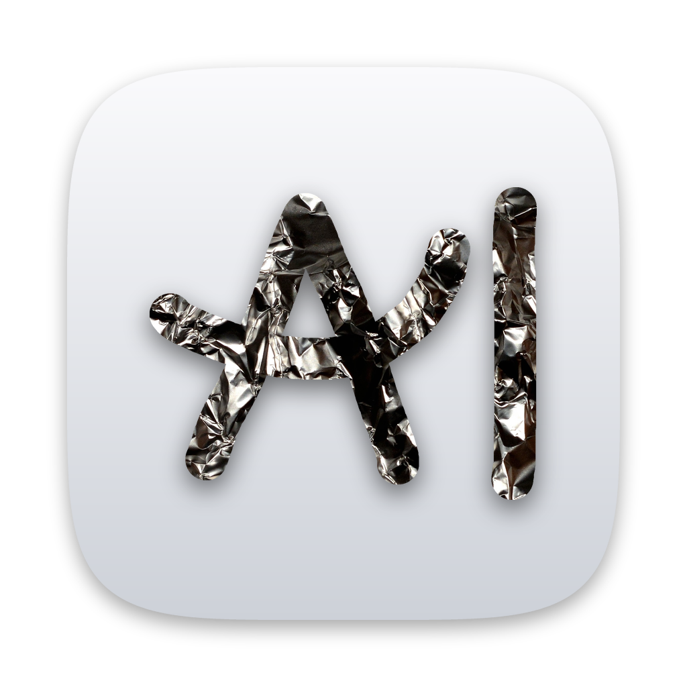

    <picture>
        <source media="(prefers-color-scheme: dark)" srcset="aluminium/branding/icon-dark.png" />
        
    </picture>
    <h1>Aluminium</h1>
    

        A personal fork of Helium that brings back the Arc features I miss.
    

## What this is

Arc is being shut down, and [Helium](https://github.com/imputnet/helium) is the closest thing to it that respects your privacy and is open source. Aluminium is Helium plus the Arc features Helium doesn't have (yet), built for my own use.

The name is a pun: in a lot of fonts "Al" looks like "AI", and AI help is allowed here (see [AI policy](#ai-policy)).

> [!IMPORTANT]
> Aluminium is **not** affiliated with or endorsed by imputnet or the Helium project. Please don't report Aluminium bugs to Helium, and don't send code from this repo to Helium's repos: Helium does not accept AI-assisted contributions.

## Status

Early days. There are no builds or releases yet. If you want a browser you can download today, use [Helium](https://helium.computer/).

## AI policy

Vibecoding is fine here, as long as you test it on a real system. Code that was only generated and never run doesn't get merged. The full rules are in [AGENTS.md](AGENTS.md).

## How this repo works

This repo works the same way as Helium's: it holds patches, resources and tooling that are applied on top of the Chromium source. Building it also needs the platform packaging repos (macOS first). For now, the [Helium macOS build docs](https://github.com/imputnet/helium-macos/blob/main/docs/building.md#development-build-and-environment) apply.

Upstream Helium is pulled in regularly so Aluminium stays on current Chromium releases and gets Helium's fixes.

## Credits

### Helium
[Helium](https://github.com/imputnet/helium) by [imputnet](https://github.com/imputnet) is what Aluminium is built on. Nearly everything in this repo is their work. If you like Aluminium, go support them.

### The Chromium project
[The Chromium Project](https://www.chromium.org/) is at the core of Helium and Aluminium, making them possible in the first place.

### ungoogled-chromium
Helium originally branched off [ungoogled-chromium](https://github.com/ungoogled-software/ungoogled-chromium).

### Other Chromium projects
Helium includes some patches from other open source Chromium projects:

- [Inox patchset](https://github.com/gcarq/inox-patchset)
- [Debian](https://tracker.debian.org/pkg/chromium-browser)
- [Bromite](https://github.com/bromite/bromite)
- [Iridium Browser](https://iridiumbrowser.de/)
- [Brave](https://github.com/brave/brave-core)

All patches are sorted by vendor in the [patches](patches/) directory of this repo.

### Arc
The features Aluminium recreates were designed by The Browser Company for [Arc](https://arc.net/). Aluminium is not affiliated with The Browser Company, and contains none of Arc's code.

## License
Aluminium changes © 2026 [vemboy200](https://github.com/vemboy200). Based on Helium © [imputnet](https://github.com/imputnet) and contributors. Both are licensed under GPL-3.0. See [LICENSE](LICENSE).

All code, patches, modified portions of imported code or patches, and any other content that is unique to Helium or Aluminium and not imported from other repositories is licensed under GPL-3.0. Any content imported from other projects retains its original license (for example, any original unmodified code imported from ungoogled-chromium remains licensed under their [BSD 3-Clause license](LICENSE.ungoogled_chromium)).
